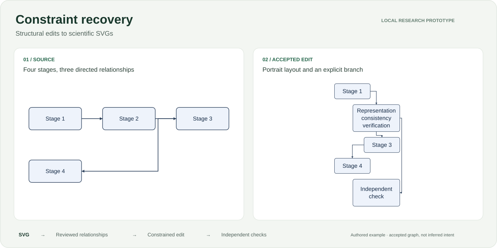

# Constraint recovery

Recover inspectable relationships from scientific SVGs, make structural edits, and check the exported result.

[](https://github.com/aamodbhatt/constraint-recovery/actions/workflows/tests.yml)


[](LICENSE)

[Demos](#demos) · [Quickstart](#quickstart) · [How it works](#how-it-works) · [Research status](#research-status) · [Roadmap](ROADMAP.md)



**Local research prototype.** The current system combines geometric recovery, optional learned endpoint ranking, explicit review and constrained editing. Broad real-figure editing and a learned advantage remain open research goals.

## Demos

| Follow an edit | Review an arrow | Annotate a compound object |
|:---|:---|:---|
| Six accepted edits, followed by an impossible request with a checkable explanation. | Inspect ambiguous endpoint candidates and save source-bound choices. | Group shapes and text into objects; record relationships and uncertainty. |
| [Edit-sequence workspace →](docs/demo/sequence/index.html) | [Attachment review →](docs/demo/attachment-review.html) | [Compound annotation →](docs/demo/primitive-annotation.html) |

These are local HTML tools. Clone the repository, run `python -m http.server 8765`, then open [the workspace](http://127.0.0.1:8765/docs/demo/sequence/index.html). The public demos use examples authored for this project.

## Quickstart

Python 3.10+. No API keys, model downloads or cloud GPU.

```sh
python3 -m venv .venv
source .venv/bin/activate
pip install -e '.[test,svg]'

constraint-recovery edit examples/pipeline.svg \
  --labels examples/labels.json \
  --width 300 --height 650 --font-size 20 --flow vertical \
  --output artifacts/edited.svg
```

Open `artifacts/edited.html` for the comparison and evidence. The command also saves the SVG, a source-bound constraint graph and a verification report. An infeasible or unverified edit exits with code 2 and writes no new diagram. Older output files may still exist: check the exit status.

## What you can do

| Capability | What it preserves or exposes | Details |
|:---|:---|:---|
| **Reflow and relabel** | Accepted node/edge identities, protected labels, requested dimensions and flow | [CLI example](docs/demo/portrait.html) |
| **Add a branch** | Existing relationships; the new node and arrow are explicit requests | [Branch example](docs/demo/branch.html) |
| **Patch the source SVG** | Supported CSS, transforms, definitions and element hierarchy | [Source-preserving subset](docs/source-preserving.md) |
| **Resolve ambiguity** | Candidate evidence and choices bound to the exact source | [Review workflow](docs/attachment-review.md) |
| **Explain a contradiction** | Independently checkable node-size, area, path-span or cycle witnesses | [Math and witnesses](docs/conflict-witnesses.md) |
| **Inspect complex figures** | Browser-derived text/shape envelopes and compound-object annotations | [Geometry](docs/browser-geometry.md) · [Annotation](docs/compound-annotation.md) |
| **Move reviewed compound nodes** | Local artwork, hierarchy, styles and relative arrow anchors through checked rigid edits | [Compound editing](docs/compound-editing.md) |

The default exporter normalizes styling. `--source-preserving` supports a broader static subset, including CSS, uniform transforms and Bezier connector recovery. The separate `edit-compound` adapter moves reviewed rich objects with browser verification. These are bounded static subsets; neither edits arbitrary SVGs.

## How it works

```text
SVG → observed geometry → reviewed relationships
    → text fitting + constrained placement + routing
    → serialized SVG → fresh import + independent checks
```

Placement minimizes total L1 node displacement subject to canvas bounds, nonoverlap and declared flow. The router searches an orthogonal visibility grid with explicit clearance and bend cost. Verification checks the accepted graph and conservative geometry after serialization.

**A correct edit of an accepted graph does not prove that the graph captures the author’s intent.** Typography estimates, stroke/marker extents, edge crossings, unsupported artwork and numerical/search limits are documented in the [method notes](docs/routing.md) and [scope](docs/source-preserving.md).

## Research status

| Experiment | Observed result | What it means |
|:---|:---|:---|
| [Endpoint ranking](results/attachment-learning.json) | The synthetic-trained model ties the tangent-aware heuristic | No established learned advantage |
| [Repeated edits](docs/edit-sequences.md) | 30/30 feasible steps pass; fresh recovery and simple packing also pass | Working behavior, not a demonstrated reuse advantage |
| [Routing](docs/routing.md) | Visibility search solves all six feasible diagnostic cases; templates solve one | A specific routing capability on authored cases |
| [External SVG audit](results/browser-geometry-audit.json) | All 1,429 primitives across 19 available sources measured | Geometry acquisition; complete-figure edit support is still **0/19** |
| [Annotation views](results/annotation-view-audit.json) | 19 private views built, zero external annotations created | Infrastructure for independent data collection |
| [Compound edits](docs/compound-editing.md) | Two successive rigid edits pass on a rich authored fixture; invalid moves and styling changes are rejected | A checked adapter, not external recovery accuracy |

The next research step is independent annotation and external evaluation of the compound-node adapter, followed by unseen papers and edit sequences. See the [research plan](docs/research-plan.md), [data protocol](data/README.md) and [model card](models/README.md). No paper-ready novelty claim is made.

Related work: [Constraint SVG](https://constraints.cs.washington.edu/web/csvg-uwtr-2000-08-04.pdf), [Mockdown](https://www.cs.cornell.edu/~jsarracino/files/mockdown-final.pdf), [Penrose](https://penrose.cs.cmu.edu/), [constraint-graph layout generation](https://arxiv.org/abs/2011.13417), [SciDiagramEdit](https://arxiv.org/abs/2607.15272), [InfoEdit](https://arxiv.org/abs/2609.33286).

## Reproduce

```sh
python -m pytest -q
python benchmarks/run_sequences.py --output artifacts/sequences.json

# Optional ELK and browser checks:
npm ci --ignore-scripts
npx playwright install chromium
python benchmarks/run_sequences.py --elk --output artifacts/sequences-elk.json
node benchmarks/browser_check.cjs
node benchmarks/compound_check.cjs
```

CI repeats the Python suite, synthetic experiments and browser checks. Results retain case-level failures and skipped requests. GPU use remains behind a [measured-need gate](ROADMAP.md#cloud-gpu-gate).

---

MIT · [License](LICENSE) · [Roadmap](ROADMAP.md) · [Saved handoff](HANDOFF.md)

External figure rights remain with their source papers; private source caches and annotation pages are not redistributed with this repository.
