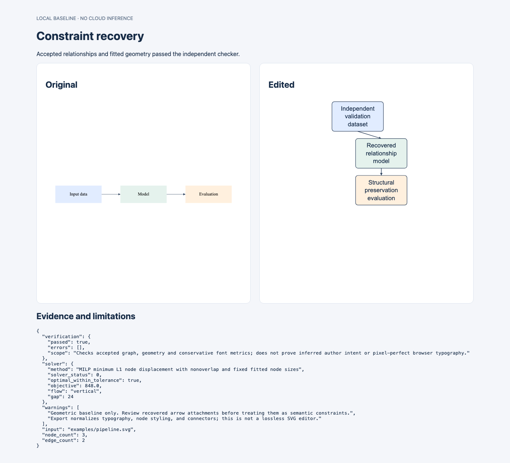

# Constraint recovery

Recover an inspectable graph from a simple scientific SVG, edit its layout through explicit constraints, and check the exported result.

**Status: geometric baseline plus a first local learning pilot.** The default engine uses explicit geometry. An optional endpoint ranker is trained on synthetic data; it currently ties a stronger hand-written heuristic. Real-diagram relationship evaluation is not complete and no research novelty is claimed.



The checked-in [example report](docs/demo/portrait.html) and SVGs can be downloaded and opened locally. On the first local 30-case synthetic run, the solver pipeline passed all 30 checks, versus 20 for the simple fixed-placement baseline. See [full results](results/local-baseline.json) for case-level errors and scope.

## Try it

Python 3.10+; CPU only. No API keys, model downloads, or cloud GPU.

```sh
python3 -m venv .venv
source .venv/bin/activate
pip install -e '.[test]'

constraint-recovery recover examples/pipeline.svg --output artifacts/recovered.json
constraint-recovery edit examples/pipeline.svg \
  --labels examples/labels.json \
  --font-size 20 --width 300 --height 650 --flow vertical \
  --output artifacts/pipeline-portrait.svg
```

Open `artifacts/pipeline-portrait.html` in a local browser. The command also writes an editable SVG, the resulting constraint graph, and a JSON verification report. To run from an existing environment without installation, prefix commands with `PYTHONPATH=src python3 -m constraint_recovery` instead of `constraint-recovery`.

## Current pipeline

```text
Supported SVG → recovered nodes and directed edges → optional human review
              → text fitting → MILP placement → connector routing
              → SVG serialization → fresh SVG import → independent checks
```

- Import rectangular nodes, editable text, and directed line/polyline/absolute M/L connectors.
- Infer text ownership by containment and connector ownership by boundary proximity. Ambiguous endpoints are rejected.
- Inspect the JSON graph; `edit --constraints reviewed.json` accepts corrections to source/target relationships while retaining source text and geometry. It requires matching primitive IDs.
- Apply replacement labels, font-size changes, and new canvas dimensions. `--flow vertical` or `horizontal` explicitly requests a directed flow layout; `free` preserves only graph connectivity and geometric feasibility.
- Insert a requested branch with `--branch SOURCE NEW_ID "Label"`; the original node/edge identities remain protected and the report records the intended graph addition.
- Fit labels with conservative Pillow font metrics. Place nodes with SciPy/HiGHS mixed-integer optimization: minimize L1 displacement subject to canvas bounds, fixed fitted sizes, pairwise nonoverlap and optional flow constraints.
- Route connectors using finite candidate paths, rejecting paths through nodes or outside the canvas.
- Re-import the exported SVG and check node/edge identities, directed connectivity, labels, typography bounds, node overlaps, arrow attachments and node-crossing connectors.

The checker checks compliance with the accepted graph. **It cannot prove that the recovered graph expresses the author's intended meaning.**

```sh
constraint-recovery edit examples/pipeline.svg \
  --branch model review "Independent review" --height 450 \
  --output artifacts/branch.svg
```

A portable [branch example](docs/demo/branch.html) is included alongside the original portrait demo.

An opt-in [source-preserving importer](docs/source-preserving.md) now handles static CSS, translated/uniformly scaled groups and quadratic/cubic connectors while patching original elements. Install `pip install -e '.[svg,test]'` and pass `--source-preserving`. See the [styled example](docs/demo/styled-portrait.html). This remains a narrow subset: the repeated external audit still accepts zero complete figures.

## First learning and external-data checkpoint

- A CPU-trained, inspectable endpoint ranker with opt-in CLI integration and abstention. See [model card](models/README.md).
- Separate synthetic training, validation and test seeds, plus a held-out scene family. The model improves over nearest-boundary matching but **ties the tangent-aware heuristic**.
- A fixed 20-row external dataset audit: 19 SVGs, one missing source, and zero supported by the strict baseline parser. All rows and first rejection reasons are retained; source figures are not redistributed.
- A pinned ELK 0.12.1 layout comparison with supplied graphs, fixed canvas checks, and case-level failures. This isolates layout from learned recovery.

See [phase findings](docs/phase1-findings.md), [annotation protocol](data/README.md), and [experiment results](results/attachment-learning.json). The immediate bottleneck is real SVG ingestion and independent annotations, not GPU training.

```sh
PYTHONPATH=src python benchmarks/learn_attachments.py
constraint-recovery recover examples/pipeline.svg \
  --endpoint-model models/attachment-ranker.json \
  --output artifacts/learned-recovery.json

# Optional mature layout baseline (requires Node.js):
npm ci --ignore-scripts
PYTHONPATH=src python benchmarks/compare_elk.py
```

## Scope and limits

The default exporter normalizes styling and geometry. It retains node IDs, labels, basic fills/strokes and accepted connectivity. Its strict importer rejects inherited styling, transforms and curves. The optional source-preserving mode supports a broader static subset described above, but neither mode edits arbitrary SVGs. Nested containers, plots, raster images, text outlines and decorative or unmarked lines remain unsupported. Start with the supplied examples or similarly simple diagrams.

Text sizing is a conservative local estimate, not browser pixel-level certification. Connector routing is a finite search and may fail even when a more sophisticated route exists. Large diagrams, dense routing and solver time limits can prevent a usable result. The baseline caps inputs at 40 nodes.

When an edit is infeasible or fails verification, the CLI exits with code 2 and does not export a new diagram. It does not silently shrink text or remove nodes. A pre-existing file at the output path is not removed on failure: check the exit status rather than treating its presence as success. Output must differ from the input path.

## Tests and benchmark

```sh
python -m pytest -q
PYTHONPATH=src python benchmarks/run.py --output artifacts/benchmark.json
```

The original seeded 30-case engineering benchmark covers longer labels, larger fonts and portrait conversion on generated chains. It compares the solver pipeline with a simple baseline that scales positions and fits text while keeping node placements fixed. Full case records and failures are retained. That original comparison is **not** against ELK, a learned model, an LLM, or external scientific diagrams; the ELK and learning pilots are separate experiments, with their own limitations.

## Research direction

The research target is recovering latent relationships from supported existing SVGs, distinguishing intended constraints from incidental geometry, representing uncertainty, and improving preservation over repeated edits.

Relevant prior work includes [Constraint SVG](https://constraints.cs.washington.edu/web/csvg-uwtr-2000-08-04.pdf), [Mockdown](https://www.cs.cornell.edu/~jsarracino/files/mockdown-final.pdf), [Penrose](https://penrose.cs.cmu.edu/), [constraint-graph layout generation](https://arxiv.org/abs/2011.13417), [SciDiagramEdit](https://arxiv.org/abs/2607.15272), and [InfoEdit](https://arxiv.org/abs/2609.33286). Constraint-based SVG layout and AI diagram editing are established areas; this repository does not claim to invent them.

See [ROADMAP.md](ROADMAP.md) for milestones and the cloud-training gate.

## License

MIT. See [LICENSE](LICENSE).
