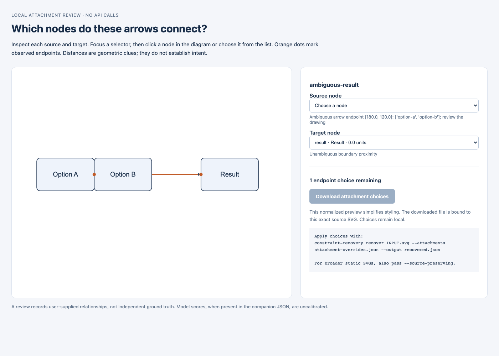

# Reviewing ambiguous arrow attachments

Previously, an ambiguous endpoint stopped recovery before a graph could be exported for correction. The `review` command now records candidate observations without pretending they form an accepted graph, and writes a portable interactive view.

```sh
constraint-recovery review examples/ambiguous.svg --output artifacts/review.json
```

Open `artifacts/review.html`. Focus a source/target selector and click a rectangle, or choose from the list. The preview uses normalized styling, not the original source rendering. It shows all candidate node IDs and boundary distances. Ambiguous endpoints start blank; model abstentions remain unselected. The download button requires a source and target for every arrow and rejects self-attachments.



Download `attachment-overrides.json`, then apply it to the same SVG:

```sh
constraint-recovery recover examples/ambiguous.svg \
  --attachments attachment-overrides.json --output artifacts/recovered.json
constraint-recovery edit examples/ambiguous.svg \
  --attachments attachment-overrides.json --output artifacts/accepted.svg
```

The manifest’s SHA-256 digest binds its decisions to the UTF-8 source text. Changing the source invalidates it. The importer validates connector IDs, node IDs, endpoint roles and self-attachments. Reports retain explicit overrides and distinguish them from geometric or experimental learned choices. Explicit choices can select a distant node; the user is declaring a relationship, and the subsequent edit reroutes it before independent validation. Conflicting `--constraints` and `--attachments` inputs are rejected.

The [checked-in demonstration choices](../examples/attachment-choices.json) select Option A as a **scripted illustrative decision**, not a new human annotation or an accuracy result. The [resulting edit](demo/reviewed-attachment.html) shows that relation preserved through layout and serialization. The ambiguity arises under the nearest-boundary baseline; it is not a claim that all geometric or semantic methods must abstain on this particular example.

Both strict and source-preserving import support endpoint review. For the broader static subset, also pass `--source-preserving`. The optional `--endpoint-model` adds uncalibrated geometric scores to the companion observations JSON. Review does not bypass unsupported artwork, ambiguous text ownership, invalid XML or unsafe content. Container/decoration roles remain a separate unresolved problem, and no automatic confidence value establishes the author’s intended graph.

## Browser integration

```sh
npm ci --ignore-scripts
npx playwright install chromium
node benchmarks/browser_check.cjs
```

The optional development dependency is pinned to Playwright 1.62.1. The integration check exercises node clicking, a real download and CLI round trip, self-attachment blocking, source-ID collisions with HTML controls and inert source text. It also edits the styled SVG with a requested 24-unit font and checks actual browser font scaling and text bounds. [The recorded local result](../results/browser-integration.json) is limited to two authored SVGs and an adversarial variation. CI repeats these checks on Linux; this is not a browser evaluation on external scientific figures.
