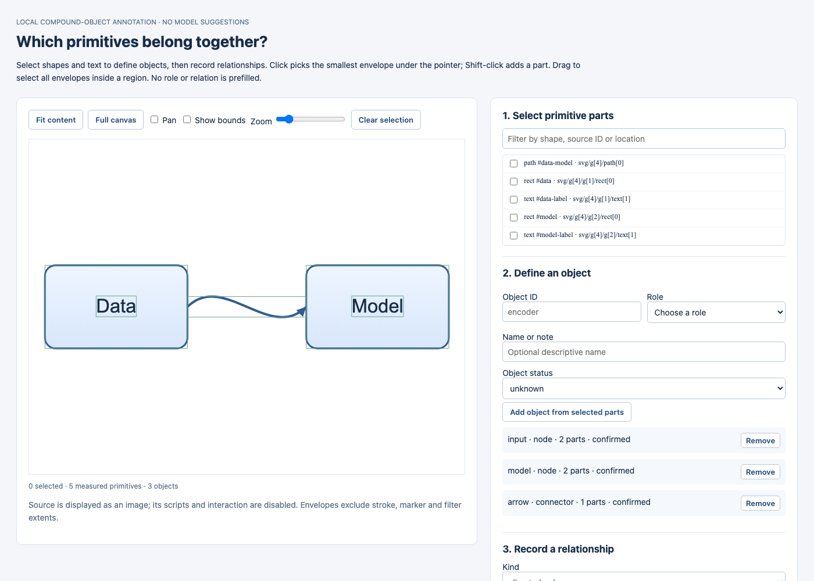

# Compound-object and relationship annotation

A [five-source unlabelled review packet](demo/native-pilot/review/index.html) is available for the fixed native-SVG development pilot. It contains no suggested objects or relations and creates no human-review claims.

Advanced imported `connector_geometry` fields identify a forward shaft and optional separately drawn end head/local tip. Resume displays these assumptions and retains them on download; entering them currently requires JSON. See the [editing contract](compound-editing.md#explicit-non-marker-geometry). A reviewer should inspect these assumptions before accepting a resumed annotation. Viewing existing agent labels is not an independent blind annotation.

The external figures contain backgrounds, frames, labels, icons and shapes that cannot all be treated as independent rectangular graph nodes. The new `annotate` command groups measured SVG primitives into explicitly labeled objects and records relationships without model suggestions.

```sh
# Optional Node/Playwright development tools:
npm ci --ignore-scripts
npx playwright install chromium
node benchmarks/measure_svg.cjs figure.svg artifacts/geometry.json --snapshot

constraint-recovery annotate figure.svg --measurements artifacts/geometry.json \
  --diagram-id my-diagram --source-url SOURCE_URL --license SOURCE_LICENSE \
  --output artifacts/annotation.html
```

Open the local HTML. Click or lasso parts, or use the primitive checklist; Shift-click adds to the selection. Assign an explicit role—node, container, connector, text, background, decoration or unknown—and an object status. A node can include several shapes and text elements. Roles and relation kinds start blank; statuses start unknown. The viewer supports content/canvas fitting, pan, zoom and primitive filtering.

Then record directed edges, containment, grouping, alignment or order between objects. A directed edge can identify a separate connector object. Self-edges are allowed in the annotation format even though the current editor cannot edit them: evaluation labels must not be forced to match implementation limits. Unknown and ambiguous relationships remain explicit. Primitive parts are disjoint across objects; containment is represented separately instead of assigning child primitives to both a frame and a node.

Download a JSON record to save; upload it through “Resume from JSON” to continue. A source digest mismatch, duplicate part assignment, broken object reference or inconsistent coverage is rejected. Removing an object referenced by a relation requires explicitly removing that relation first.

[Open the authored demo](demo/primitive-annotation.html). The screenshot below shows a **scripted fixture exercise**, not independent human annotations:



## Provenance and validation

The [version 2 schema](../data/annotation-v2.schema.json) adds compound objects and explicit primitive coverage to the original proposed relation-only format. It retains source hashes, source URL, license, split, annotator type/identity, evidence and per-object/relation status. Unassigned primitives remain listed, so partial annotation cannot silently become a complete-diagram label set.

```sh
constraint-recovery check-annotation downloaded.annotation.json \
  --source figure.svg --measurements artifacts/geometry.json
```

The checker validates structure, source binding, primitive/object references and coverage. It **does not verify semantic truth or the actual identity of an annotator**. Review metadata is self-reported. `human-reviewed` requires a declared human identity and evidence; an agent record cannot use that status. The checked-in [scripted example](../examples/styled-pipeline.annotation.agent.json) is marked `agent-reviewed`, with evidence stating that it is a workflow test. There is still no independently human-annotated external test set.

## Display and measurement scope

Use `--snapshot` when measuring for annotation or comparison. The measurement browser records a PNG from the same viewport as the primitive envelopes, with source/image hashes and pixel dimensions. The tool validates those bindings and embeds the PNG as an inert image. This prevents implicit SVG dimensions or CSS sizing from stretching the drawing independently of its overlays. The original SVG bytes remain unchanged. Explicitly sized SVGs without stylesheets retain a legacy SVG-image fallback; implicit/CSS-sized sources without a snapshot are refused with a remeasurement instruction. Hashes bind supplied evidence; they do not prove an untrusted image was faithfully captured.

Source scripts are disabled and secondary file/network references blocked during measurement. Browser tests include a source-script message probe and independent pixel probes on the styled authored fixture and two native figures without explicit dimensions. Snapshots are bounded to 8,192 pixels per side, 16 million pixels and eight MB of PNG data. Blocked assets, missing primitive envelopes and effect-affected envelopes are disclosed; inspect the original before confirming semantics. Font fallback can vary across machines.

Overlays exclude stroke/marker outlines and filter/clipping effects. Animated/conditional stylesheets and root CSS transforms remain outside the annotation preview scope. A few pixel probes are regressions for projection, not a complete rendering-fidelity certificate.

Generated HTML contains source artwork, and full measurements contain source geometry and, with `--snapshot`, its image. Keep mixed-rights figures under ignored `artifacts/` or `.cache/`. Public examples include authored MIT fixtures and the separately attributed [native pilot](native-pilot.md). The original reconstructed-SVG audit remains 0/19 complete-figure editing; the native development track is separately reported at 3/5 two-move sequences under agent-reviewed assumptions.

Old private annotation pages built without a snapshot must be regenerated before human labeling:

```sh
node benchmarks/measure_external.cjs --rows 20 --snapshot --output artifacts/geometry-audit.json
python benchmarks/build_external_annotations.py --rows 20 --output artifacts/annotation-view-audit.json
```

`python benchmarks/build_external_annotations.py --rows 20` builds the existing development prefix from private cached sources and measurements. The [build audit](../results/annotation-view-audit.json) creates 19 unlabelled views, retains the missing twentieth source and creates **zero annotations**. Views and source copies remain in ignored `.cache/annotation-views/`. A successful build is not a rendering-fidelity certificate. See the [research gate](research-plan.md) before treating these development figures as evaluation data or training another model.
