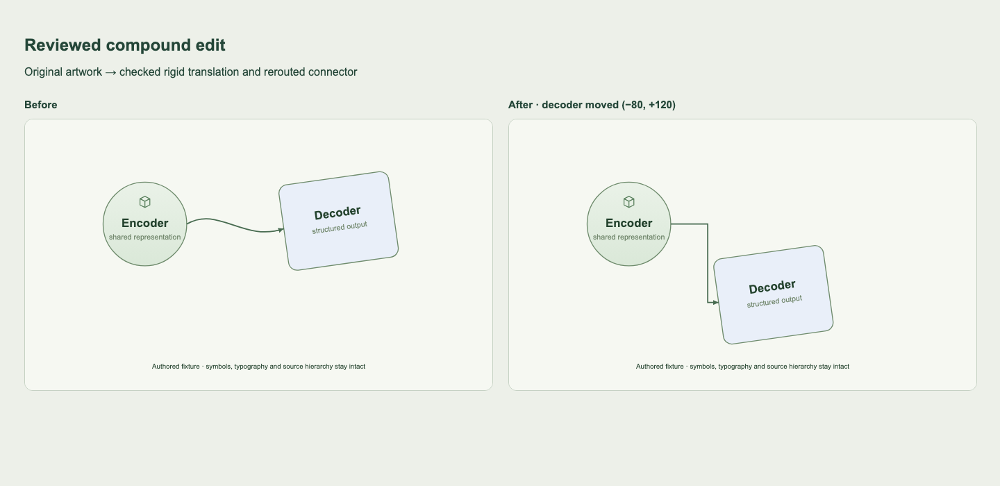

# Reviewed compound edits

`edit-compound` translates explicitly reviewed objects in a rich static SVG. A node can contain circles, text, symbol instances and rotated artwork. The adapter preserves the original hierarchy and local artwork, reroutes affected arrows, then measures the serialized candidate in a fresh browser page before exporting it.

This is a rigid-edit adapter, not automatic object recovery or a general layout solver. The [native SVG development pilot](native-pilot.md) completes two frozen moves on 3/5 figures under agent-reviewed assumptions. The separate reconstructed-SVG audit remains **0/19**. Neither track establishes independent recovery accuracy.



## Run the example

Install the Python SVG extra and local browser dependencies from the repository root:

```sh
pip install -e '.[svg]'
npm ci --ignore-scripts
npx playwright install chromium

constraint-recovery edit-compound examples/compound.svg \
  --annotation examples/compound.annotation.agent.json \
  --moves examples/compound-moves.json \
  --output artifacts/compound-moved.svg
```

The moves file maps confirmed node IDs to `[dx, dy]` in normalized viewBox units. The example moves `decoder` by `[-80, 120]` and preserves its rotation, bold text and relative arrow attachment. The encoder includes a circle, gradient and symbol instance.

Successful output includes the SVG, `.report.json`, `.compound.json` and `.measurements.json`. A rejected or unverified candidate exits with code 2 and exports no new SVG. Existing outputs can remain; check the exit code. The multi-file publication is not an atomic filesystem transaction: an I/O failure during publication can leave sidecars updated before the SVG.

For another edit, use the derived state alongside the edited source:

```sh
constraint-recovery edit-compound artifacts/compound-moved.svg \
  --constraints artifacts/compound-moved.compound.json \
  --moves next-moves.json --output artifacts/compound-next.svg
```

The state binds to the current SVG but retains the original annotation snapshot and its review provenance. A chain of input/output hashes records subsequent edits; it does not imply that a reviewer inspected every derived SVG. These hashes detect mismatched files, not maliciously forged provenance.

## Geometry and checks

For a primitive with local transform `L`, measured parent transform `P` and requested global translation `T`, the replacement transform is:

```text
L' = P^-1 T P L
```

This handles nonsingular affine ancestors without reparenting elements. The diagnostic includes skew/nonuniform-scale and reflected parent variants as well as the rotated card. Moving leaves rather than groups can activate attribute-based CSS selectors, so the checker compares computed styles across every element, including text spans and definitions. It also compares source attributes, hierarchy, text and comments, allowing only the requested transforms and connector coordinates to change.

Arrows retain their original endpoint offsets relative to the accepted objects. Measured endpoint tangents determine escape directions, and the visibility-grid router searches with eight-unit clearance. A separate serialized-segment check and fresh endpoint measurements validate the result. Bounding envelopes, affine linear parts, declared ordering/alignment/group relations and container boundaries are checked independently of the placement request.

By default, `--routing channel` first tries ordered tracks for supported parallel groups, then falls back to visibility search. `--routing visibility` retains the independent-search control. The [channel notes](channel-routing.md) derive the track constraints and describe a separate check of actual serialized shaft contacts. `parallel_shaft_checks` and `warnings` expose nonzero contacts; a routing preference alone does not certify separation. These checks do not cover every edge in a figure or stroke/head extents.

## Supported boundary

- Only confirmed node objects move. Containers, unknown objects and unassigned parts remain protected; uncertainty touching a moved object requires review.
- Rerouting accepts a single marked line, polyline or open unfilled path. An unmarked shaft needs explicit forward geometry in the annotation. A separately drawn filled end head can translate with its target when its terminal direction is axis-aligned; its exact local artwork and relative tip offset are checked. A line that needs bends is rejected. Arbitrary multipart arrows, arrow-label groups and shared ownership remain unsupported.
- When both accepted endpoint objects translate identically, the entire connector can translate rigidly. Its source curve, fill and start/mid/end markers stay unchanged. Rerouting start/mid markers is declined because new vertices could create new markers.
- Known empty root-level Inkscape/Sodipodi named-view records and RDF/DC/CC provenance records inside SVG metadata are retained and checked. This does not admit arbitrary foreign content or remove source metadata to force compatibility.
- Static SVG only: no scripts, events, external resources, nested viewports, dynamic CSS or unresolved clipping/filter/mask effects. Source JavaScript and secondary requests are disabled during measurement.
- Browser measurements are limited to 500 primitives per edit. Geometry tolerance is 0.05 viewBox units. Conservative envelopes can reject visually feasible moves.
- Text, node size, canvas and artwork are not redesigned. The checker does not establish author intent, pixel identity, stroke/marker collision bounds or absence of edge crossings/shared segments. Multiple rerouted links can overlap visually even while their accepted endpoint identities remain correct.

## Explicit non-marker geometry

For reviewed connections whose meaning is not encoded by a single SVG end marker, a connector object may include:

```json
"connector_geometry": {
  "shaft": "svg/g[29]/line[0]",
  "direction": "forward",
  "end_head": {"part": "svg/g[29]/path[1]", "tip": [270.67, 66.43]}
}
```

`forward` means the source object attaches to the shaft's SVG start and the target to its end. The optional end head is a member of the same connector object; `tip` uses that head primitive's own measured SVG coordinate system. Omitting `end_head` describes a reviewed connection without a separate head. Only the listed shaft and optional head may belong to this connector. These fields are review assumptions, not recovered truth. They remain in the original annotation snapshot across edits; the local tip is transformed through fresh browser geometry each time. The annotation UI preserves this metadata on resume, while advanced geometry entry currently uses JSON.

## Reproduce the evidence

```sh
PYTHON=.venv/bin/python node benchmarks/compound_check.cjs
```

The [saved diagnostic](../results/compound-integration.json) covers two edits, original-review retention, output binding, an impossible move that preserves existing output, and a CSS-triggered styling change that must be rejected. Separate damaged candidates change text, a gradient definition, a moved shape's pose or an arrow endpoint; fresh browser measurements and the checker reject each. This is an integration diagnostic on an authored fixture, not independent recovery accuracy or evidence of a learned advantage.
