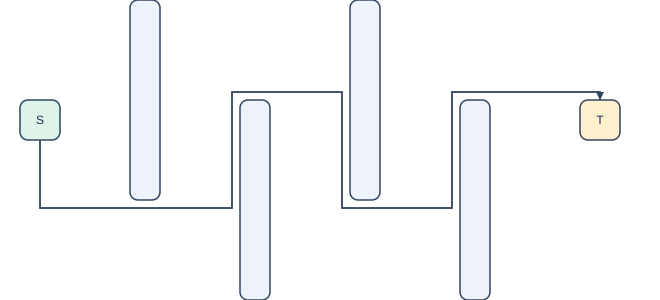

# Orthogonal routing

The default router builds shared grid coordinates from each rectangle’s inflated sides and center axes, plus the canvas boundary. Grid intersections inside an inflated rectangle are removed; adjacent horizontal/vertical grid intervals that cross an obstacle interior are removed. The default clearance is eight viewBox units. Each node has four side-center ports. A short normal segment escapes the endpoint’s own inflated box while avoiding all other inflated obstacles.

Dijkstra search runs over `(grid position, incoming axis)`, so its nonnegative cost is path length plus eight units per direction change. Multiple source ports are initial states; all target ports are terminal candidates. A recovered path is simplified to bend vertices. A separate clipping guard checks original node interiors. The CLI then serializes the SVG, reparses it and independently checks graph identity and geometry.

The solver reports path length, bends, search cost, visited states and grid size for each connector. Search has an explicit state budget and the grid has a vertex budget. The node-placement engine still caps diagrams at 40 nodes. This searches the constructed graph optimally when the budget is not exceeded; it does not claim global optimality over arbitrary curves, ports, edge crossings or glyph/marker outlines. Connectors are routed independently, so edge-edge crossings and shared segments can occur.

## Paired diagnostic

`python benchmarks/compare_routing.py` compares the previous finite templates with visibility search on the **same fixed geometry and eight-unit clearance**, using six authored feasible cases and one blocked case. Both outputs pass through the same fresh-import checker and an independent expanded-rectangle clearance check. Source/target escape segments may enter only their own inflated box.

The [recorded run](../results/routing-comparison.json) solves six feasible cases with visibility search versus one with templates; both reject the blocked case. The alternating barriers intentionally require routing behavior outside the old templates. This demonstrates a specific capability, not general real-figure accuracy or a research novelty claim. Runtime is recorded for reproducibility, not a benchmark speed claim. The optional `--router candidates` CLI mode retains the historical template router with its original zero-clearance checks; the paired diagnostic explicitly gives that router the same eight-unit clearance as the new router.

The original 30-case synthetic layout benchmark still passes all 30 cases under the new default. The supplied-graph ELK comparison remains 10 MILP passes and seven ELK passes out of 15 generated canvas requests, with five MILP requests infeasible. Historical reports retain their original routing configuration; rerun to measure the current version.
